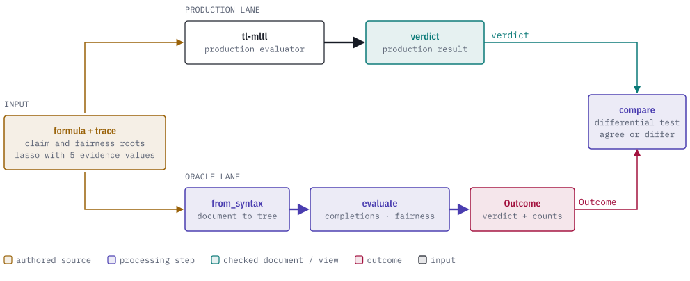
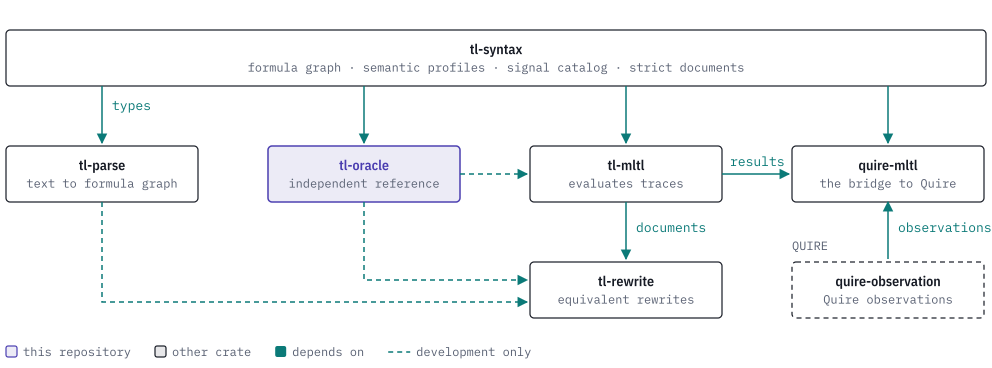

# tl-oracle

[](https://discord.gg/k8DVhuYBR2)
[](#license)
[](Cargo.toml)

tl-oracle is an independent second implementation of Mission-time Linear Temporal
Logic (MLTL) semantics, for checking an evaluator. It evaluates a formula
directly from the definition of each operator over finite words and over
ultimately periodic words (lassos), and returns a verdict for one trace.

Where observations are missing or conflicting, it enumerates every Boolean
completion and reports how many are fair. Use it as a dev-dependency in
differential tests: when tl-oracle and your evaluator disagree on a trace, one of
them is wrong.

<picture>
  <source media="(prefers-color-scheme: dark)" srcset="docs/images/hero-dark.svg">
  
</picture>

## Getting started

tl-oracle is not on crates.io. Depend on it through git as a development dependency:

```toml
[dev-dependencies]
tl-oracle = { git = "https://github.com/agent-ix/tl-oracle" }
```

Add `rev = "<commit>"` to pin a commit. It needs the Rust version in `rust-version` in `Cargo.toml`, or newer.

To build from a clone:

```sh
git clone https://github.com/agent-ix/tl-oracle.git
cd tl-oracle
cargo build --release
```

## Usage

This evaluates `p & !p` on a lasso whose loop is one cell with no observation of
`p`. The formula is false under both completions of `p`, so the verdict is
`Refuted`, with the reason for the open evidence recorded.

```rust
use std::collections::BTreeMap;
use tl_oracle::{evaluate, Evidence, Formula, Lasso, Limits, Uncertainty, Verdict};
use tl_syntax::PropositionId;

let p = PropositionId(0);
let cell = BTreeMap::from([(p, Evidence::Missing)]);
let lasso = Lasso::new(vec![], vec![cell]).unwrap();

let claim = Formula::And(
    Box::new(Formula::Atom(p)),
    Box::new(Formula::Not(Box::new(Formula::Atom(p)))),
);
let outcome = evaluate(&claim, &[], &lasso, 0, Limits::default()).unwrap();
assert_eq!(outcome.verdict, Verdict::Refuted);
assert_eq!(outcome.fair_completions, 2);
assert_eq!(outcome.uncertainty, Uncertainty::Missing);
```

More examples are in [docs/examples.md](docs/examples.md).

## Reference

| Function | Input | Result |
| --- | --- | --- |
| `evaluate` | Oracle `Formula`, fairness premises, `Lasso`, position, `Limits`. | `Outcome` with a `Verdict`. |
| `evaluate_syntax` | A validated tl-syntax infinite formula graph, claim and fairness roots, `Lasso`. | `Outcome`. |
| `evaluate_documents` | An infinite formula document and a lasso trace document. | `Outcome`, after profile, clock and proposition-map checks. |
| `evaluate_closed_trace_v1` | Formula, complete finite word, position. | `bool` under `mltl.closed-trace/v1`. |
| `evaluate_origin_complete` | Formula, complete finite word, position. | `bool` under `mltl.origin-complete-history/v1`. |
| `evaluate_finite` | Formula, complete finite word, position. | `bool` under the original finite clauses, used by the finite partition and law tests. |
| `from_syntax` | A validated tl-syntax infinite formula graph and a root. | Oracle `Formula`. |

| Type | Role |
| --- | --- |
| `Formula`, `Interval` | The oracle's own formula tree: 17 node kinds, closed or unbounded intervals. |
| `Lasso`, `Evidence` | A prefix and a nonempty loop. Each cell holds `False`, `True`, `Missing`, `Conflicting` or `Impossible` per proposition. |
| `Limits` | Maximum depth, offset, positions and completions. |
| `Verdict` | `Proved`, `Refuted` or `Inconclusive`. |
| `Outcome` | The verdict, whether each truth value is possible, the count of fair completions and an `Uncertainty`. |
| `OracleError` | A refusal or an exhausted resource limit. It is never a truth value. |
| `population` | `PopulationLedger`, which counts the cases of a declared finite partition. |

See [docs/api-reference.md](docs/api-reference.md),
[docs/evidence.md](docs/evidence.md) and
[docs/why-an-oracle.md](docs/why-an-oracle.md).

## The TL stack

tl-oracle is the reference evaluator that tl-mltl and tl-rewrite test against.

<picture>
  <source media="(prefers-color-scheme: dark)" srcset="docs/images/tl-stack-dark.svg">
  
</picture>

## Building and testing

```sh
cargo fmt --check
cargo clippy --all-targets -- -D warnings
cargo test
```

The exhaustive and law tests are described in
[docs/why-an-oracle.md](docs/why-an-oracle.md#how-the-oracle-is-checked).

## Contributing

Run the three commands under Building and testing before opening a pull
request. Changes are discussed on the [Discord](https://discord.gg/k8DVhuYBR2).

## License

Licensed under the [MIT license](LICENSE).
