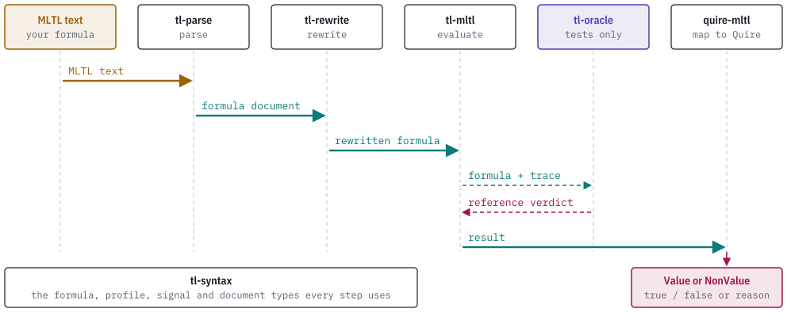

# How it works

## The formula tree

The oracle defines its own `Formula` tree. It has 17 node kinds: `False`, `True`, `Atom`, the Boolean connectives `Not`, `And`, `Or`, `Implies` and `Equivalent`, the future operators `Future`, `Globally`, `Until` and `Release`, and the past operators `Once`, `Historically`, `Since`, `Triggered` and `StrongPrevious`. Temporal nodes carry an `Interval`, which is `Closed { start, end }` or `Unbounded { start }`. Atoms use the `PropositionId` type from tl-syntax.

`from_syntax(graph, root)` copies one root of a validated tl-syntax infinite formula graph into this tree. It matches every node kind exhaustively and calls no tl-syntax evaluator. A node that is shared by two parents is copied once for each parent. The copy fails with `ResourceIncomplete` at depth 64 or after 65,536 nodes, and with `GraphRootAbsent` when the root is not in the graph.

## Evaluating a lasso

`evaluate(claim, fairness, lasso, position, limits)` follows these steps.

1. Collect the propositions that the claim, the fairness premises and the lasso mention.
2. Refuse with `InconsistentInput` if any cell has `Impossible` evidence.
3. List every proposition at every cell whose evidence is `Missing` or `Conflicting`. Each one is an unknown. A proposition that a cell does not list is `Missing`.
4. Refuse with `ResourceIncomplete` when `2^unknowns` exceeds `max_completions`.
5. For each completion, give each unknown one Boolean value. The value is the same wherever that cell is read, in every reference to the proposition and on every lap of the loop.
6. Evaluate each fairness premise on the completed word. The completion is fair when every premise holds at some position of the loop, which means it holds infinitely often. Discard the completion otherwise.
7. Evaluate the claim at `position` on each fair completion and record whether it was true, false or both.
8. Refuse with `EmptyFairAdmission` when no completion is fair. Otherwise return the `Outcome`.

Evaluating one completion is a recursive denotation over periodic sequences. Each subformula becomes a sequence of Boolean values with a start index and a period. Future operators read ahead along the sequence. Past operators read behind and look for a repeating pattern, which they must reach within a bounded number of extra laps or the result is `NoPeriodicFixedPoint`. [evidence.md](evidence.md) describes the result record.

## The bounded profile evaluators

Three functions evaluate a complete finite word, which is a slice of cells that map each proposition to `bool`. They take a position inside the word and return `bool`.

| Function | Past operators | Future operators | U and R guard | Atoms outside the word |
| --- | --- | --- | --- | --- |
| `evaluate_closed_trace_v1` | Refused with `ClosedTracePastUnsupported`. | Evaluated. | Starts at the interval's lower endpoint. | False. |
| `evaluate_origin_complete` | Evaluated across the origin. | Refused with `OriginFutureUnsupported`. | S and T guards start at the interval's lower endpoint. | False, including before the origin. |
| `evaluate_finite` | Window stops at the origin. | Evaluated. | Starts at offset zero. | False. |

All three refuse an open interval with `UnboundedFiniteInterval` and an inverted closed interval with `InvertedInterval`. `evaluate_closed_trace_v1` and `evaluate_origin_complete` treat a proposition missing from a cell as false. `evaluate_finite` returns `FinitePropositionMissing` when a referenced proposition is missing from a cell of the word.

`evaluate_finite` predates the two profile functions. It keeps its guard and origin rules so that the finite partition and law tests keep their meaning, and it is not a comparison target for an owner profile.

## Limits

`Limits` has four fields. The defaults are 64 for `max_depth`, 4,096 for `max_offset`, 65,536 for `max_positions` and 65,536 for `max_completions`.

| Field | Bounds |
| --- | --- |
| `max_depth` | Formula nesting depth. |
| `max_offset` | The largest interval bound, including the stabilization prefix of a past operator. |
| `max_positions` | Cells materialized for one subformula. The profile evaluators use it as their step budget. |
| `max_completions` | Completions enumerated. It applies to lasso evaluation. |

A limit that is exceeded returns `ResourceIncomplete`. The crate never turns incomplete exploration into a verdict.

## Where the crate sits

A formula passes through several crates on its way from text to a Quire outcome. tl-oracle takes no part in that path. In tests it receives the same formula and trace as tl-mltl and returns a second result.

<picture>
  <source media="(prefers-color-scheme: dark)" srcset="images/pipeline-dark.svg">
  
</picture>

The dependency structure between the crates is in the [README](../README.md#the-tl-stack).
